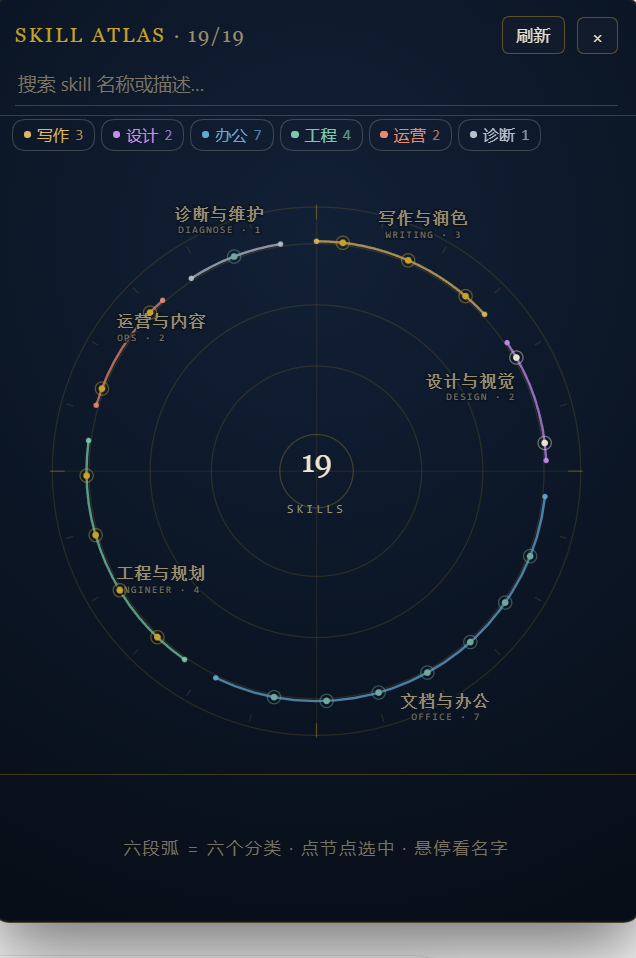
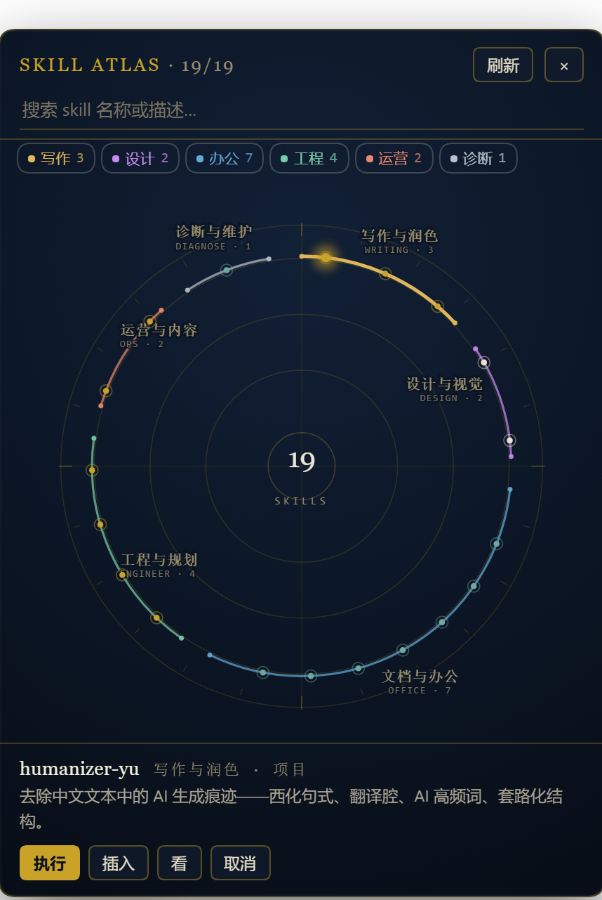

# dsh-plugin-skill-panel

给 DeepSeek Harness 的 Web GUI 加一颗「🧩 Skills」胶囊：点开是一张**星图**，本机全部 skill 是盘上的星点，按用途分成六段弧线。点一颗星就能看它的描述、把调用语塞进输入框，或者直接发出去。



## 它长什么样

- **同心刻度环 + 十字准线**：背景是天文图录的网格，不承载信息，只给盘面一个坐标感。
- **六段弧线 = 六个用途**：写作与润色、设计与视觉、文档与办公、工程与规划、运营与内容、诊断与维护。每段一色，段名常显在弧外侧（中文大字 + 英文小字 + 该类条目数），弧本身加粗到 2px、两端带封口点，是盘面上最重的一层标注。
- **星点颜色 = 装在哪儿**：金 = 项目级 `.dsh/skills`，象牙 = 用户级 `~/.dsh/skills`，青 = 随应用内置，淡蓝 = `~/.agents/skills`。
- **图例条**：搜索框下面那排 chip（写作 3 / 设计 2 / 办公 7 …），点一下只看这一类，再点回到全部。
- **中心「19 SKILLS」**：当前盘上有多少个可调用项。
- **搜索时**：命中的节点跳到前景、名字直接长在盘上，标题变成 `SKILL ATLAS · 2/19`。
- **悬停**：节点放大并发光，名字浮出来。



点中一颗星后，底部换成它的信息条：名字、来源、两行描述，以及「执行 / 插入 / 看 / 取消」。被选中的星会持续发光，它所在的弧线也会提亮。

## 三个按钮

| 按钮 | 行为 |
| --- | --- |
| **执行** | 把 `使用 skill \`<名字>\` 完成任务：<输入框里已有的话>` 组合成一轮对话，**直接发送**。输入框为空时退化为"只插入前缀"；只有前缀没有需求时提示先补需求，不会发半截话。 |
| **插入** | 只写进输入框，你自己补需求再回车。 |
| **看** | 直接预览该 skill 的 `SKILL.md` 正文。 |
| **取消** | 取消选中，回到提示态。 |


调用语已经存在时（比如你刚点了另一个 skill 的执行），只替换前面的 skill 名，不会把前缀越叠越长。

## 安装 / 卸载

```powershell
# 安装（会把包 link 进 profile，并把包名追加到 dsh.profile.bundles）
& "<dsh 安装目录>\resources\runtime\cli\bin\dsh.cmd" plugin --profile desktop add "<插件目录>"

# 卸载
& "<dsh 安装目录>\resources\runtime\cli\bin\dsh.cmd" plugin --profile desktop remove dsh-plugin-skill-panel
```

装完**重启一次 DeepSeek Harness**（宿主在启动时给页面生成插件清单，刷新页面不足以加载新的 client 半身）。

## 结构

| 文件 | 作用 |
| --- | --- |
| `src/index.mjs` | 宿主半身：`apply(ctx)` 里向 `webServer` 注册 4 条 JSON 路由 |
| `src/scan.mjs` | 扫描器：发现 skill 根目录、解析 frontmatter、去重合并 |
| `src/client.js` | 客户端半身：React 组件挂在 `shell.overlay` slot 上，盘面是手写 SVG |
| `cordis.patch.yml` | 插件自带的 patch，声明 `- id: skill-panel` 插入条目 |
| `smoke.mjs` | 宿主侧冒烟测试（mock ctx 调 apply，验证路由与数据） |
| `verify-starmap.py` | 用 playwright 在 web profile 实例里验证星图：节点数、弧数、选中卡片、插入输入框、搜索、分类筛选 |
| `verify-starmap.py` | playwright 验证星图客户端：节点数、弧数、选中卡片、插入输入框、搜索、分类筛选 |
| `design-demos/` | 视觉探索留下的候选稿：六个列表方向（`dir-1..3` 完整版）与三个星图方向（`g1` 知识图谱 / `g2` 星图 / `g3` 径向树），最终选了 `g2` |

## 分类怎么定的

盘面上的六段弧是**用途分类**，按下面的优先级判断，没有额外元数据：

1. 名字查表：`humanizer-yu` / `natural-chinese` / `paper-humanizer` → 写作；`huashu-design` / `huashu-art-motion` → 设计；`office*` → 办公；`diagnose-windows-sandbox-acl` → 诊断；`tencent-channel-community` / `wechat-oa-style` → 运营；`domain-modeling` / `grill*` → 工程。
2. 描述关键字兜底：出现 docx / xlsx / pptx / excel / powerpoint 归办公，出现 写 / 润色 / 文案 / humaniz 归写作，出现 设计 / 视觉 / 动画 归设计，出现 频道 / 公众号 / 运营 / community 归运营，出现 诊断 / debug 归诊断。
3. 都认不出来的归「工程与规划」。

这是启发式，不是 skill 自己声明的分类。新增 skill 如果落错段，去 `src/client.js` 的 `CATEGORY_BY_NAME` 加一行就行。

## 数据来源与扫描规则

只认一层深度：`<root>/<name>/SKILL.md` 或 `<root>/<name>.md`；frontmatter 里的 `description` / `whenToUse` / `name` 被解析。

根目录按优先级：

| rank | 来源 | 路径 | 星点颜色 |
| --- | --- | --- | --- |
| 100 | project | 当前 workspace 的 `.dsh/skills`（workspace 列表读自 `~/.dsh/storages/workspace.json`） | 金 `#C9A227` |
| 400 | user | `~/.dsh/skills` | 象牙 `#E8E2D0` |
| 500 | agents | `~/.agents/skills` | 淡蓝 `#9FB6D4`（暂无数据时不画） |
| 600 | bundled | `<安装目录>/resources/runtime/office-skills` 等随包资源 | 青 `#6FA8A0` |

同名 skill 高级别覆盖低级别；某个来源一个 skill 都没有时，对应弧线不画。

## HTTP 路由

| 方法 | 路径 | 说明 |
| --- | --- | --- |
| GET | `/skill-panel/list` | 全部 skill + roots + errors |
| POST | `/skill-panel/refresh` | 强制重扫 |
| GET | `/skill-panel/read?name=<名字>` | 返回该 skill 的 `SKILL.md` 正文（只在扫描结果白名单内读，512KB 上限） |
| GET | `/skill-panel/health` | 存活探针 + 上次扫描时间 |

## 排障

- **改了 `src/*.mjs` 不生效**：cordis 不会卸载已 apply 的宿主插件，`plugin remove` 后重新 `add` 也不会重新 import。必须重启 DeepSeek Harness。客户端（`src/client.js`）改完刷新页面即可。
- **胶囊被别的浮卡挡住**：vault-memory 的知识库浮卡占右下角，本插件胶囊定位在 `bottom: 200px`、面板在 `bottom: 150px` 避让。
- **星点挤成一坨**：节点按组均布在弧线上，同名组超过 12 个时会挤，用搜索缩范围。
- **`dsh --profile web` 里 host 路由全 404**：web profile 下第三方插件的 `webServer` 路由不生效（vault-memory 同样 404），不是本插件的问题；验证客户端时用 playwright 拦截 `/skill-panel/*` 返回 fixture 数据（见 `verify-starmap.py`）。

## 开发自检

```powershell
node smoke.mjs        # 宿主侧：路由注册、分组、read、路径穿越拦截
node test-scan.mjs    # 纯扫描器输出（无需宿主）
python verify-starmap.py "http://127.0.0.1:<port>/?token=<token>"   # 客户端星图（需 playwright + 一个 web profile 实例）
```
